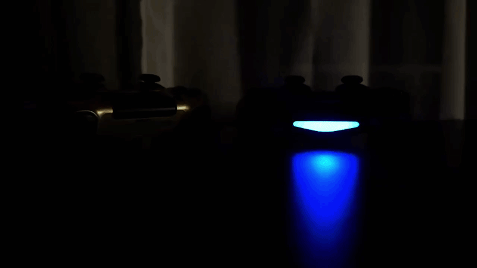
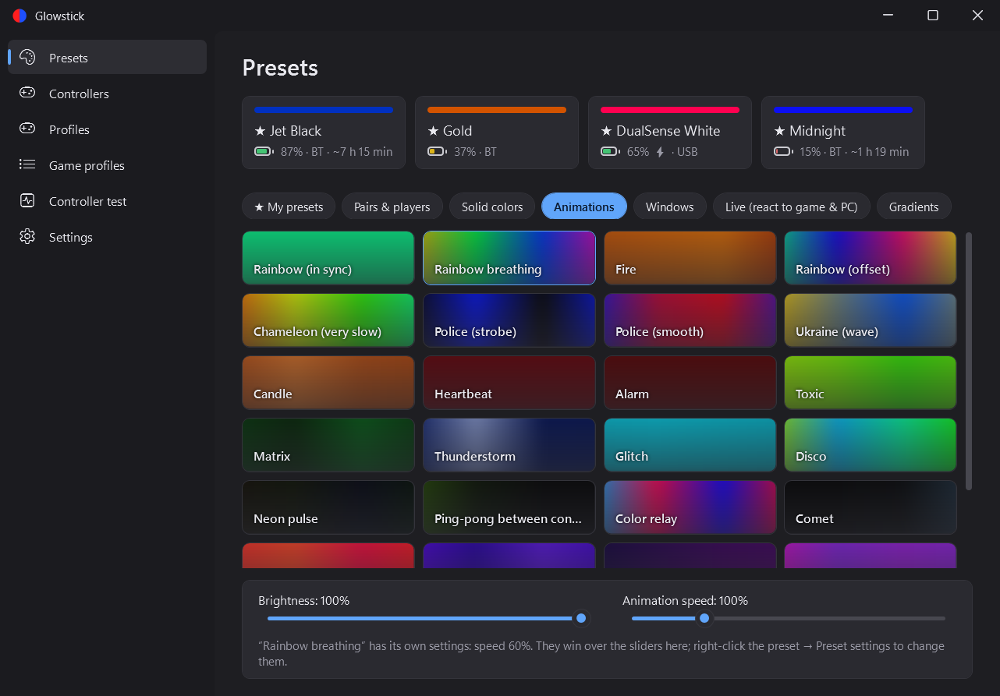
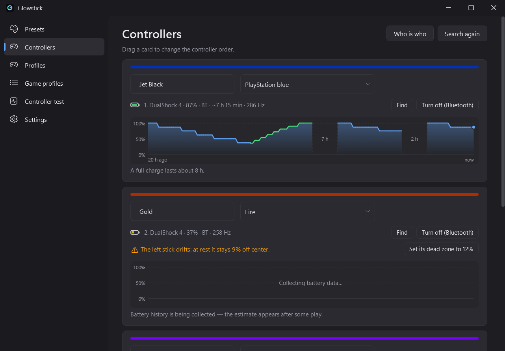
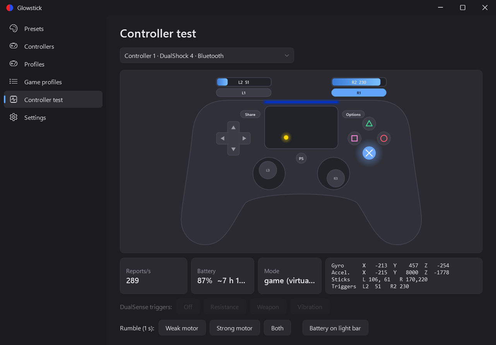
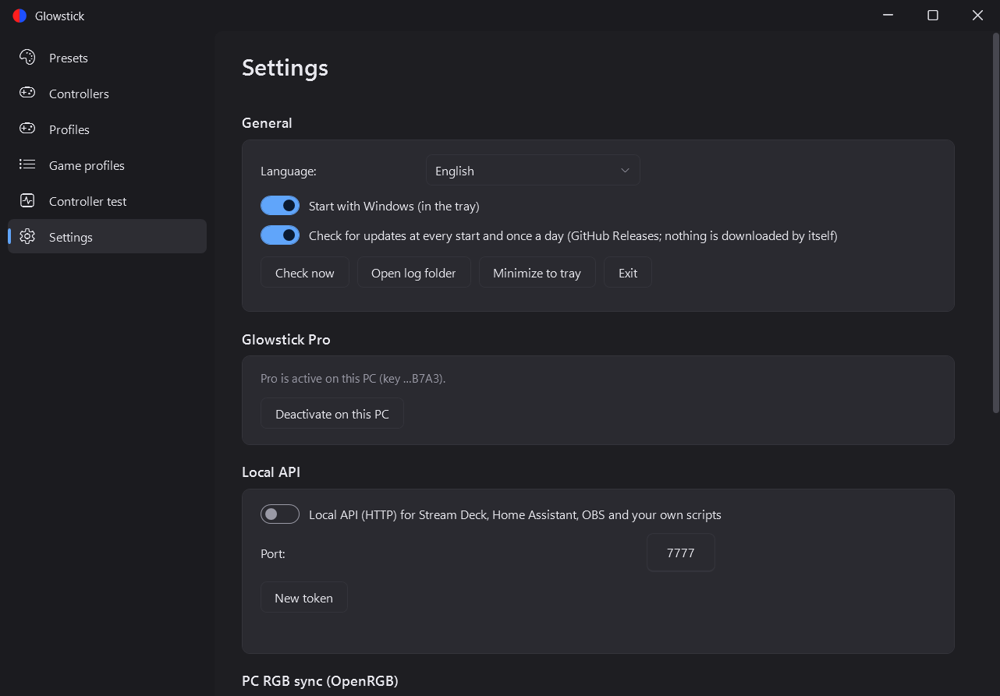
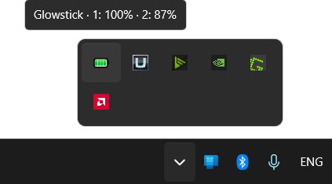

<div align="center">

# Glowstick

**Light bar control for DualShock 4 and DualSense on Windows.**

[](https://github.com/tkachuktaras/glowstick/releases/latest)
[](https://github.com/tkachuktaras/glowstick/releases)
[](https://github.com/tkachuktaras/glowstick/actions/workflows/build.yml)
[](LICENSE)

[**Download**](https://github.com/tkachuktaras/glowstick/releases/latest) · [Features](#features) · [How it works](#how-it-works) · [Building](#building)



</div>

Pick a color or an animation for your controllers' light bars, see their battery in the tray, use the touchpad as a mouse — and play without the controller fighting with your games. One portable exe, 11 languages, free and open source.

## Download

Get **`Glowstick.exe`** from the [latest release](https://github.com/tkachuktaras/glowstick/releases/latest) and run it — it's a single portable file, `SHA256.txt` is next to it. On the first start Glowstick offers to install two small drivers it needs (see [How it works](#how-it-works)).

Requirements: Windows 10/11, .NET Framework 4.7.2+ (already in Windows), a DualShock 4 or DualSense over USB or Bluetooth.

## Screenshots

| Presets | Controllers |
|---|---|
|  |  |
| **Controller test** | **Settings** |
|  |  |

## Features

### Free

- **Presets:** solid colors, pairs and player colors, and three animations (Rainbow, Rainbow breathing, Fire); brightness and speed sliders.
- **One controller** with everything below; more controllers come with Pro.
- **DualSense:** light bar, rumble, battery, touchpad and gyro; the player LEDs show the controller's number.
- **Battery in the tray:** the icon shows the charge; notifications and a red blink at 25% and 12%.

  

- **Hotkeys (hold PS):** ←/→ preset, ↑/↓ brightness, ✕ show battery, □ touchpad as mouse, Options — turn off a Bluetooth controller. Every one of them can be moved to another button or turned off in Settings.
- **Touchpad as mouse:** one finger — cursor, two — scroll (both directions); tap to click, double-tap drag, trackball glide, jitter compensation, absolute mode; turns itself off in fullscreen games.
- **Controller test:** buttons, sticks, triggers, touchpad, gyro, report rate, rumble.
- **Updates:** a check once a day; one click on “Update” downloads the new version, verifies its SHA-256 and restarts Glowstick.

### Glowstick Pro

- **All animations and gradients**, and **live presets** that react to music, the screen, the battery, the triggers and the stick.
- **Any number of controllers:** animations spread across all of them; names and own presets per controller; drag them to change the order.
- **Your own presets:** colors, speed and offset between controllers; **buttons** and **sticks** that light up in their own colors; export / import as `.glowstick` files.
- **Input mapping**, as capable as DS4Windows: remap any button, stick direction, trigger stage, touchpad region / swipe or tilt to a controller button, a key, the mouse, a macro or a special action (switch profile, launch a program, turn off…); tap / hold / double tap, turbo, toggle and shift layers on any source; macros with pauses and key down / up, typed or recorded; stick and trigger dead zones, response curves, stick → mouse and flick stick; gyro → mouse or stick with smoothing, acceleration and calibration; rumble strength. Everything lives in **input profiles**.
- **Game profiles:** a preset and an input profile of their own while a given game is running (matched by exe, wildcards or window title).
- **Battery history:** a graph of the last 24 hours, how long a full charge lasts, a warning when the battery wears out.
- **[Local API](docs/local-api.md)** for Stream Deck, Home Assistant, OBS and your own scripts — switch presets and set colors or effects live.

The free version and Pro share their settings (`%APPDATA%\Glowstick`), so moving to Pro keeps everything.

## How it works

When a game and Glowstick both talk to the same controller, they get in each other's way: the light bar flickers between the two, some games stop seeing the controller at all. Glowstick avoids that:

1. The real controller is hidden from every program except Glowstick by the **HidHide** driver.
2. Glowstick creates a virtual **DualShock 4** for each controller with the **ViGEmBus** driver — that's what games and Steam see, with the PS button, touchpad and gyro. A DualSense is translated into a DualShock 4.
3. Input goes from the real controller to the virtual one on a highest-priority thread, with no timers or queues — about 10 µs added.
4. Rumble from the game goes straight back to the real controller together with the light bar.

When Glowstick exits, hiding is turned off and the controllers are restarted, so games see the real ones right away.

> Games that rumble only through XInput (an Xbox controller) don't rumble a DualShock 4 unless they run through Steam Input.

<details>
<summary><b>Drivers, files and removal</b></summary>

The official ViGEmBus 1.22.0 and HidHide 1.5.230 installers are embedded in the exe; their digital signature (Nefarius Software Solutions) is verified before they run.

| What | Where |
|---|---|
| ViGEmBus | `C:\Program Files\Nefarius Software Solutions\ViGEm Bus Driver\` + the driver store |
| HidHide | `C:\Program Files\Nefarius Software Solutions\HidHide\` + a HID filter driver |
| Settings and log | `%APPDATA%\Glowstick\` |
| Autostart / start without UAC | Task Scheduler tasks `Glowstick` and `Glowstick UI` |

Administrator rights are needed to control HidHide. UAC appears only on the first launch; after that Glowstick starts itself through its scheduled task.

To remove everything: tray → right click → **“Remove drivers and settings…”**. It uninstalls both drivers, deletes the scheduled tasks and `%APPDATA%\Glowstick`, then closes; delete the exe yourself. The drivers can also be removed in “Programs and Features”.

</details>

## Translations

English, Українська, Deutsch, Français, Español, Português (Brasil), Italiano, Nederlands, 日本語, 한국어, 简体中文. Translations live in [`lang/`](lang); see [CONTRIBUTING.md](CONTRIBUTING.md#translations) to fix one or add a language.

## Building

```powershell
powershell -ExecutionPolicy Bypass -File build.ps1        # → dist\Glowstick.exe
powershell -ExecutionPolicy Bypass -File tools\test.ps1   # automated tests
```

Only .NET Framework 4.7.2+ is needed — `csc.exe` ships with every Windows 10/11. The project layout and code style are in [CONTRIBUTING.md](CONTRIBUTING.md).

## Contributing

Ideas, bugs and new presets go to [Issues](../../issues); how to build and what to check before a pull request is in [CONTRIBUTING.md](CONTRIBUTING.md). Report vulnerabilities privately — see [SECURITY.md](SECURITY.md).

## License

Glowstick is free software: [GNU GPL v3](LICENSE) or later. Third-party components (ViGEm.NET, ViGEmBus, HidHide) are under their own licenses — see [THIRD-PARTY-NOTICES.md](THIRD-PARTY-NOTICES.md).

Glowstick is an independent project, not affiliated with Sony Interactive Entertainment. “DualShock”, “DualSense”, “PlayStation” and “PS4” are trademarks of Sony Interactive Entertainment Inc.
