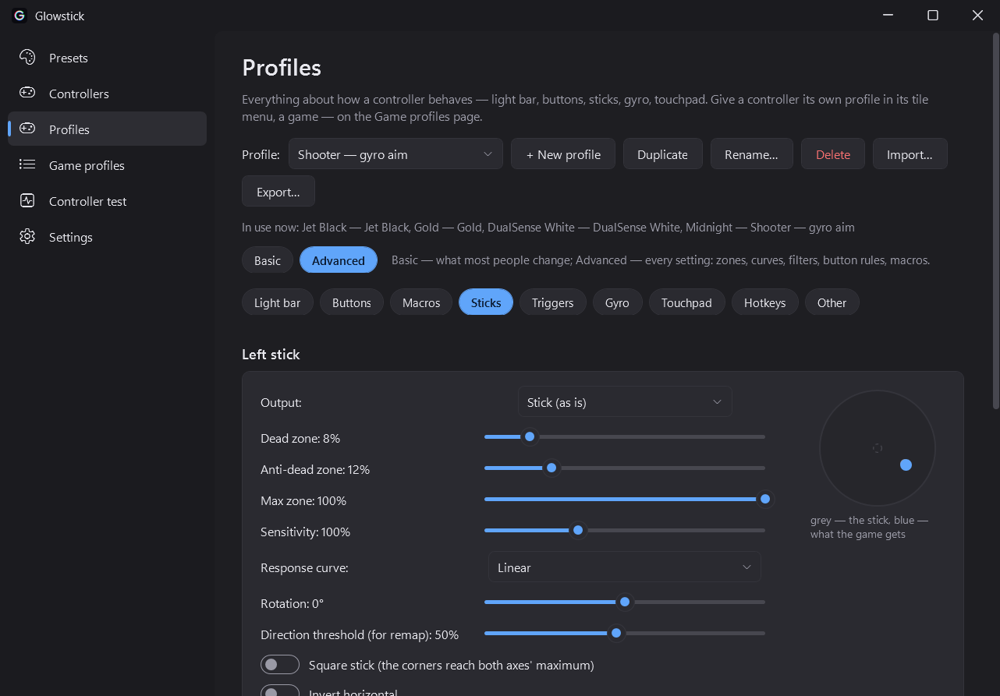
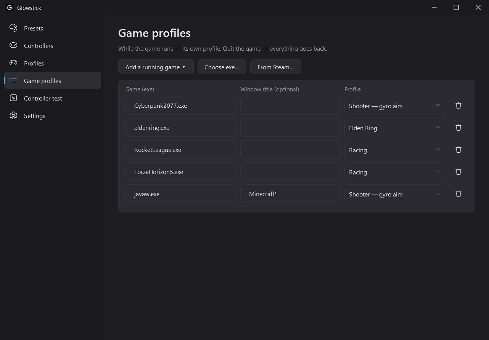
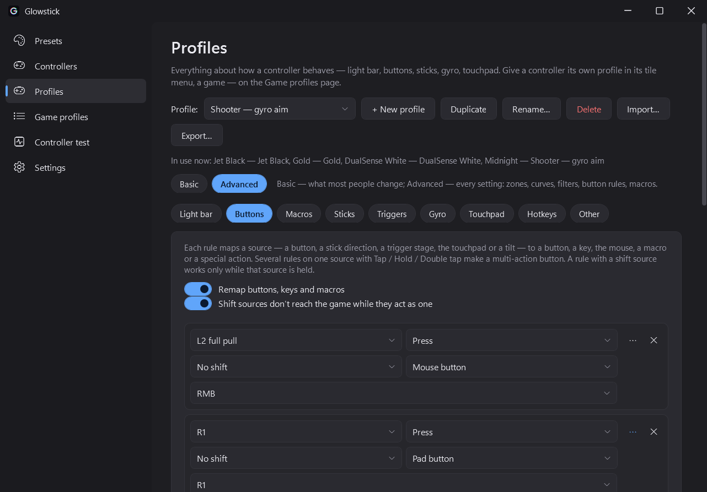
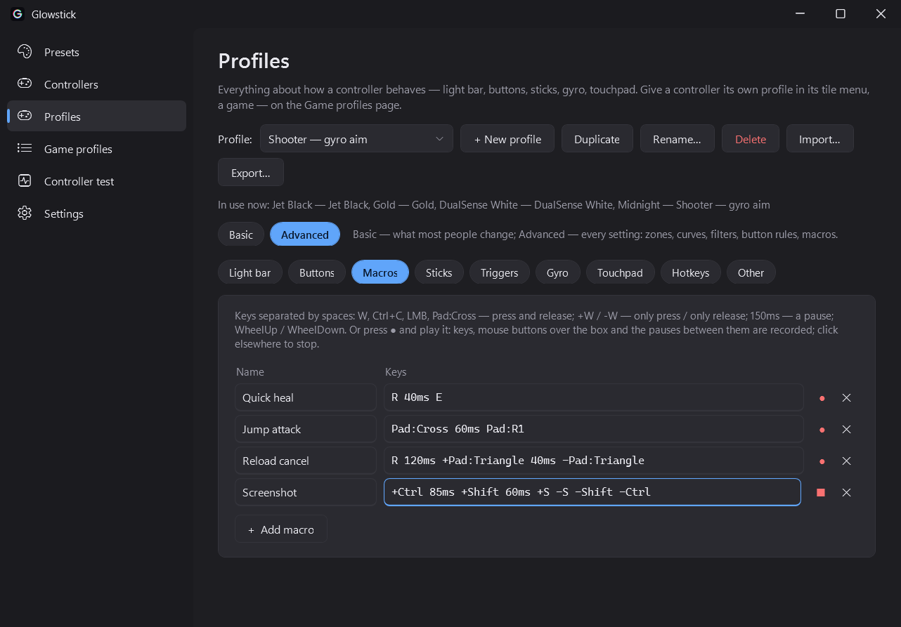
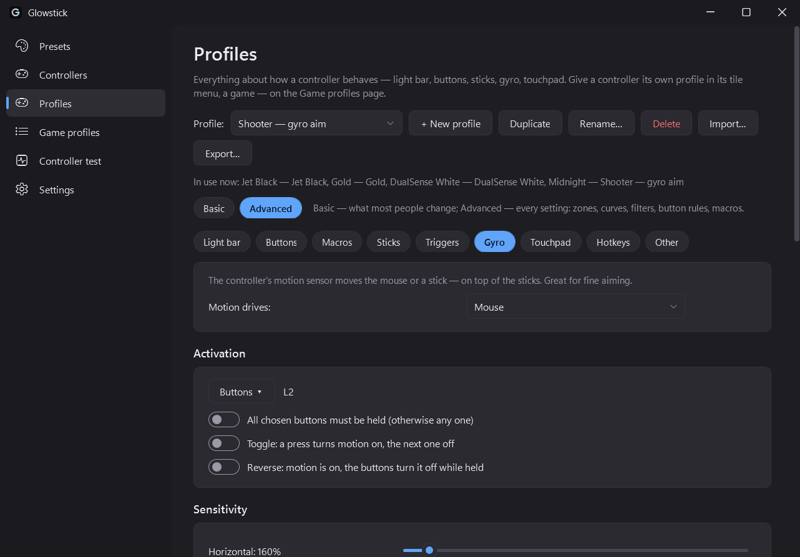
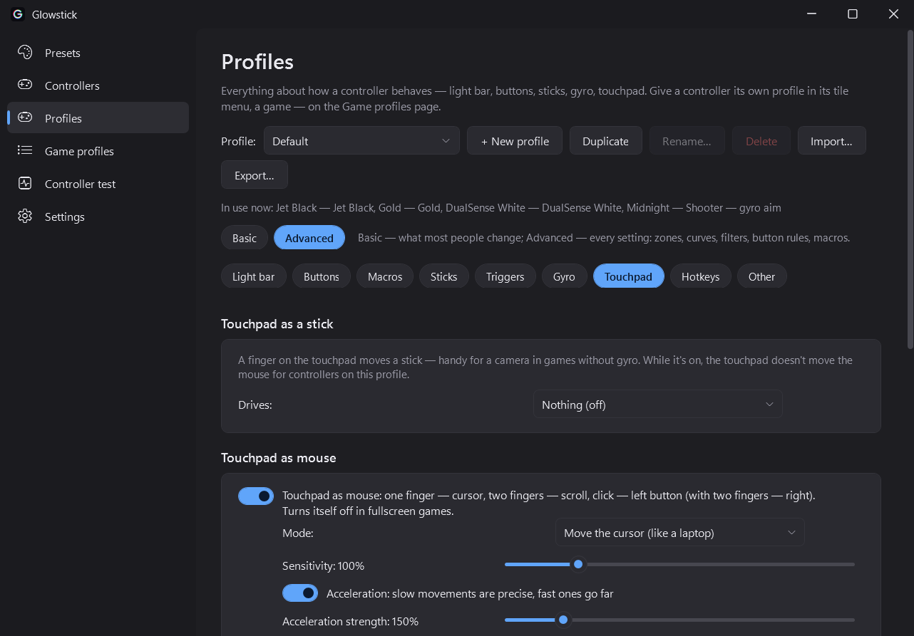
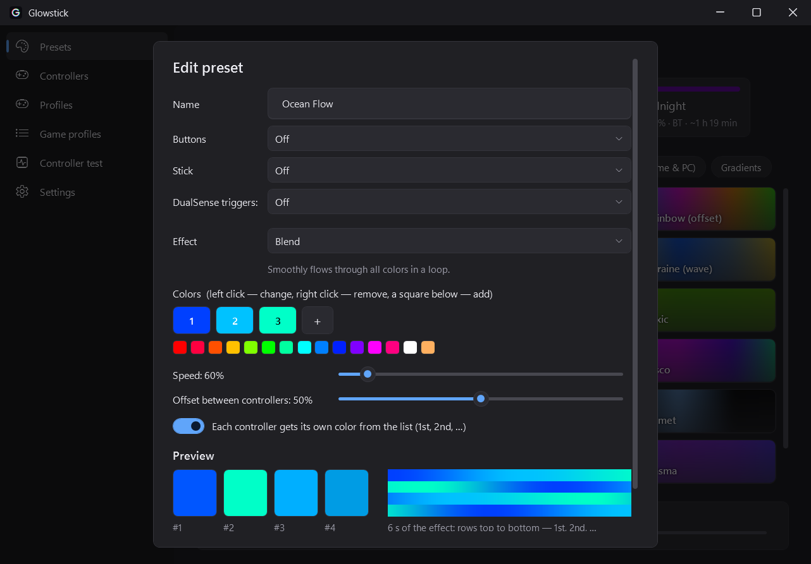

<div align="center">


# Glowstick

**Light bar, input mapping and game integrations for DualShock 4 and DualSense on Windows.**

[](https://github.com/tkachuktaras/glowstick/releases/latest)
[](https://github.com/tkachuktaras/glowstick/releases)
[](https://github.com/tkachuktaras/glowstick/actions/workflows/build.yml)
[](LICENSE)

[**Download**](https://github.com/tkachuktaras/glowstick/releases/latest) · [Features](#features) · [How it works](#how-it-works) · [Building](#building)


</div>

Set the color and animation of your controllers' light bars, watch their battery from the tray, use the touchpad as a mouse — and play without Glowstick getting in the game's way: games get a virtual controller, the real one stays with Glowstick.

## Download

Get `Glowstick.exe` from the [latest release](https://github.com/tkachuktaras/glowstick/releases/latest) and run it. On the first start it offers to install the two drivers it needs.

Needs Windows 10/11 and a DualShock 4 or DualSense (USB or Bluetooth).

## Screenshots

| Presets | Controllers |
|---|---|
|  |  |
| **Profiles** | **Game profiles** |
|  |  |
| **Button rules** | **Macros** |
|  |  |
| **Gyro aiming** | **Touchpad** |
|  |  |
| **Controller test** | **Settings** |
|  |  |
| **Preset editor** | |
|  | |

## Features

### Free

- **Game mode:** games get a virtual DualShock 4 and never see the real controller, so Glowstick and the game don't fight over it; rumble goes through.
- **Presets:** solid colors, pairs, player colors, three animations and two Windows-based ones (accent color, wallpaper); brightness and speed.
- **The game's own light bar:** games that set the light bar (health, chases, team colors) show it on the real controller.
- **Battery in the tray** with low and "charged" alerts and the time left or to full; on the charger the light bar shows the charge filling up.
- **Hotkeys (hold PS):** switch presets, brightness, battery, touchpad mouse, desktop mode, on-screen keyboard, turn a Bluetooth controller off.
- **Touchpad as mouse:** cursor, scrolling, taps, drag, trackball glide, edge swipes, light click feel; turns itself off in fullscreen games.
- **Desktop mode:** with no game in front the controller drives Windows — cursor, scrolling, Enter, Esc, switching windows.
- **DualSense:** light bar, rumble, battery, touchpad, gyro, player LEDs, adaptive triggers (test).
- **Power:** the light bar dims when the controller is put down; a Bluetooth controller turns itself off when idle.
- **Controller health:** weak Bluetooth link and stick drift warnings, find a controller (rumble + flash), who is who.
- **Steam Input check:** warns when Steam also handles the controller (double input, wrong prompts) and says how to turn it off.
- **Controller test:** buttons, sticks, triggers, touchpad, gyro, rumble.
- **Backup** of all settings in one file, made by itself before every update; one-click **updates**; 11 languages.

One controller in the free version.

### Glowstick Pro

- **Any number of controllers**, with names, their own presets and brightness; **Xbox 360** as the virtual controller; **co-pilot** (two controllers play as one).
- **All animations and live presets** that react to music, the screen, the battery, triggers and sticks; **music presets** can listen to one app only or to everything but some apps (Windows 11).
- **Your own presets**, shareable as files.
- **Profiles** for every controller and game, switched automatically (also by a Steam game): light bar, input mapping, touchpad, rumble; import and export as files.
- **Input mapping** on par with DS4Windows: remap buttons, sticks, triggers, touchpad and motion to buttons, keys, mouse, macros or actions; shift layers, tap / hold / double, turbo, toggle; dead zones and curves; flick stick; the touchpad as a stick; editable hotkeys.
- **Gyro:** aiming with the mouse or a stick, smoothing, acceleration, gyro swipes, real-world calibration (a full turn of the controller is a full turn in the game); **motion server (Cemuhook / DSU)** for Cemu, Yuzu / Ryujinx, Dolphin and other emulators.
- **Adaptive triggers** (DualSense): your own feel per profile — resistance, weapon click or vibration — tried live on the pad.
- **Game telemetry** on the light bar: shift lights in racing games (Forza, F1, Assetto Corsa, Dirt / Grid, iRacing, BeamNG, AMS2 and more), health in CS2, Dota 2 and League of Legends, boost in Rocket League, ship alarms in Elite Dangerous, G-load in X-Plane.
- **Steam library** → game profiles in one click.
- **DualSense:** the Mute button switches the PC microphone and its light shows it (or the battery, touch…); haptic rumble.
- **PC lighting sync:** OpenRGB and Razer Chroma; Corsair iCUE and Xbox controllers as a source — experimental.
- **Battery history** and wear warning.
- **[Local API](docs/local-api.md)** for Stream Deck, Home Assistant, OBS and scripts, with an input overlay for streams.

The free version and Pro share their settings, so moving to Pro keeps everything.

## How it works

A game and Glowstick talking to the same controller get in each other's way. So Glowstick hides the real controller from games ([HidHide](https://github.com/nefarius/HidHide)) and gives them a virtual one instead ([ViGEmBus](https://github.com/nefarius/ViGEmBus)) — a DualShock 4 or, in Pro, an Xbox 360. That's why it needs the two drivers and administrator rights. When Glowstick exits, games see the real controllers again.

To remove everything: tray → **Remove drivers and settings…**

## Translations

English, Українська, Deutsch, Français, Español, Português (Brasil), Italiano, Nederlands, 日本語, 한국어, 简体中文 — see [`lang/`](lang).

## Building

```powershell
powershell -ExecutionPolicy Bypass -File build.ps1        # → dist\Glowstick.exe
powershell -ExecutionPolicy Bypass -File tools\test.ps1   # tests
```

Details in [CONTRIBUTING.md](CONTRIBUTING.md).

## License

[GNU GPL v3](LICENSE) or later. Third-party components: [THIRD-PARTY-NOTICES.md](THIRD-PARTY-NOTICES.md).

Not affiliated with Sony Interactive Entertainment. “DualShock”, “DualSense” and “PlayStation” are trademarks of Sony Interactive Entertainment Inc.
